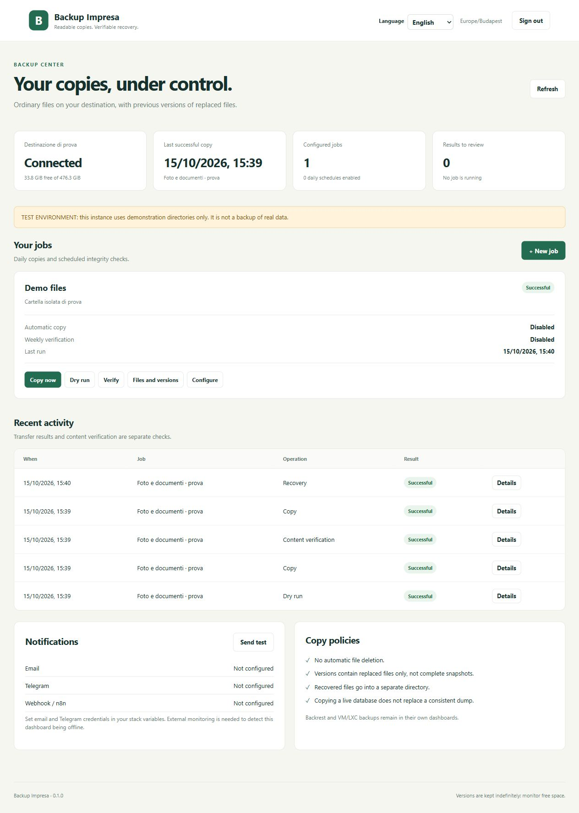

# Backup Impresa

A self-hosted backup dashboard for **readable file copies, SSH server downloads and encrypted Restic snapshots**, with verification, separate-folder recovery, email/Telegram and n8n webhooks.

**Start here:** [Step-by-step English guide](docs/GUIDE.en.md) · [Guida italiana](docs/GUIDE.it.md) · [Guía española](docs/GUIDE.es.md). The same guides are available inside the panel.

**English · [Italiano](docs/README.it.md) · [Español](docs/README.es.md)**


**Initial release / early access.** Tested with Linux containers and real rsync operations on demonstration data. Validate recovery on your own storage before relying on it. No production data or credentials are included in this repository.



## What it does

- Italian, English and Spanish interface and guided practical examples.
- Graphical SSH server setup: key generation, pinned host identity and connection test.
- Generic file downloads and Oracle completed-manifest downloads with SHA256 verification.
- Local/SFTP Restic repositories, snapshots, sampled integrity checks, verified restores and explicit retention preview/apply.
- Graphical SMTP/Telegram/n8n settings, encrypted secret storage, persistent webhook delivery retries and scoped incoming automation API.
- Read-only source mounts; destination identity marker and free-space checks.
- Daily copy, weekly checksum verification, manual dry run and detailed results.
- One serialized queue, persistent configuration and recovery of interrupted-run status.
- Replaced files retained in timestamped `versions/`; **no automatic deletion**.
- File browser and restore into `/restores`, followed by a content check.
- Email via SMTP with TLS, Telegram and optional HTTPS webhook for n8n.
- Separate notification failure reporting and a warning if an enabled job has no successful copy in 30 hours.

Restic is integrated directly. Existing Backrest and Proxmox jobs remain independent unless you explicitly migrate them; never give two panels simultaneous ownership of retention.

## Choose your installation

| Method | Requirements | Guide |
| --- | --- | --- |
| Portainer | Docker host managed by Portainer | Steps below |
| Docker Compose | Docker Engine + Compose v2; no Portainer | [Compose guide](docs/INSTALL.md#2a-docker-compose-without-portainer) |
| Docker CLI | Docker Engine; no Compose or Portainer | [Complete docker run command](docs/INSTALL.md#2b-docker-cli-without-compose) |
| Native VPS / Linux | Node.js 22+, npm, rsync and systemd; no Docker | [Native installer and service](docs/INSTALL.md#2c-native-vpslinux-without-docker) |

Step-by-step installation: **[English](docs/INSTALL.md) · [Italiano](docs/INSTALL.it.md) · [Español](docs/INSTALL.es.md)**. Public VPS access uses an SSH tunnel or HTTPS; loopback binding is the default. Native installer: `sudo bash deploy/install-native.sh` from a reviewed release checkout, after installing prerequisites. It leaves the service stopped for storage/configuration setup.

## Install with Portainer

1. Prepare three host directories: source, destination and restores. On an external drive, **verify the actual disk is mounted before creating directories or markers**. Check with `findmnt -T /your/destination`. Do not create a destination marker on an unmounted fallback directory.
2. In the source directory create an empty `.backup-impresa-source`. In the destination directory create `.backup-impresa-target` containing `backup-usb-v1` followed by a newline (or your chosen `TARGET_ID`). These markers are safety checks; they do not replace mount monitoring.
3. In Portainer open **Stacks → Add stack → Repository**. Use `https://github.com/MarlonMarketing/backup-impresa`, reference `refs/tags/v0.2.1`, Compose path `compose.yaml`.
4. Set `SOURCE_PATH`, `TARGET_PATH`, `RESTORE_PATH`, `TARGET_ID`, `TZ` and `BIND_ADDRESS` under environment variables. Use the server's LAN address for remote LAN access. Default `127.0.0.1` accepts access from the host only. Container root needs source read and destination/restore write permissions; an unprivileged LXC has its own UID mapping. Do not fix this by making all files world-writable.
5. Deploy. In the container console run `cat /data/setup-token`. Open `http://YOUR_SERVER:9899`, select your language and create your account with that token. The token file is removed after setup. Do not publish it.
6. Create a job with schedules disabled. Run **Dry run → Copy now → Verify → recover a test file**, then compare the restored file with the original. Only then enable schedules.
7. For alerts configure SMTP and/or Telegram in **Notifications and n8n settings** (or existing environment variables) and press **Send test**. Set `NOTIFICATION_LANGUAGE=it`, `en` or `es`. Leave `NOTIFY_SUCCESS=false` for failure notifications only.

Use a VPN or trusted HTTPS reverse proxy for access beyond your LAN. With HTTPS set `COOKIE_SECURE=true`. Do not expose the plain HTTP port directly to the internet. Never mount the Docker socket.

## Local Docker build

With Docker Engine and Compose v2 installed, prepare the directories/markers described above, copy `.env.example` to `.env`, edit it, then run:

```sh
docker compose -f compose.yaml -f compose.local.yaml up -d --build
```

Published images are versioned at `ghcr.io/marlonmarketing/backup-impresa:0.2.1`. The supplied image is Linux amd64. Other architectures require a local build. Versions are deliberately pinned; updates are manual.

## Copy and version semantics

`current/JOB/` contains ordinary files you can open without this application. When rsync replaces a file, its previous content moves to `versions/JOB/RUN/`. Those directories contain **only replaced files, not full historical snapshots**. Deleting a source file does not delete its current copy. There is no automatic garbage collection: versions, logs and restores grow until managed by an administrator.

Regular copies use rsync's size and timestamp comparison; checksum verification reads file content and can detect changes that preserve both. A successful copy alone is not a checksum verification. Verification compares the source as it exists now; newly added/changed files can legitimately differ from an older backup. The browser shows at most 1,000 entries per directory. Symlinks, permissions, ownership, ACLs and special filesystem features are not preserved. NTFS filename restrictions still apply: test your actual dataset.

Live files can change during a run. For databases, create a consistent application dump first. The app does not create PostgreSQL/MySQL dumps and cannot guarantee a transactionally consistent live library. For Immich copy the **entire media directory plus a recent database dump**; test the application's full recovery procedure separately. Do not copy a running PostgreSQL data directory as a database backup.

Sources are explicitly allowlisted in `BACKUP_SOURCES` JSON, each with `id`, `name`, `path` under `/sources` and optional `requiredPaths`. Add matching read-only bind mounts in Compose. Optional `"dumpDirectory":"backups","maxDumpAgeHours":26` checks freshness of a dump directory (see source code for exact matching). For new source data, create a new job rather than mixing it with existing copies.

## Backup the dashboard itself

Persist and protect `/data` (account hash, jobs, schedules and run metadata); logs also live there. Keep `.env` credentials in a private password manager, not Git. Your readable file copy remains usable if the dashboard is lost. A restore into a new dashboard requires account/configuration recovery or a fresh setup; it does not reconstruct jobs automatically from the copied files.

Downloads and repositories default to the state volume for trials. For dedicated disks see [compose.storage.yaml](compose.storage.yaml) and the guide; verify mounts and identity markers first.

The internal health check and stale-run warning cannot alert when the container or server is off. Add an independent external monitor. Keep another backup on a separate/offline destination; a connected writable drive alone does not protect against every failure.

## Development and verification

```sh
docker build -t backup-impresa-test .
docker tag backup-impresa-test backup-impresa:0.2.1-test
docker build -f Dockerfile.test -t backup-impresa-fixtures .
docker run --rm --network none --memory 1g --entrypoint node backup-impresa-fixtures --test --test-concurrency=1 test/*.test.mjs
```

Tests cover actual rsync copies, multiple replaced-file versions, corruption, recovery, path boundaries, authentication/CSRF, destination identity, free-space refusal, scheduling and translation catalogue parity. GitHub Actions repeats them before publishing a tagged image. Tool output and low-level system diagnostics retain their original language. See [CONTRIBUTING](CONTRIBUTING.md) and [SECURITY](SECURITY.md).

GitHub Actions also installs the native package on an isolated systemd runner, starts it as the dedicated service user, checks the source is mounted read-only and exercises an actual copy, checksum verification and restore through the HTTP API.

MIT licensed. Contributions and translations are welcome through issues and pull requests.


## Version 0.2 safety and limits

Existing schema-1 jobs are preserved. New tasks are disabled by default. No repository is auto-initialized, no existing Backrest data is deleted, no readable versions or remote downloads are automatically purged. Restic retention apply is an explicit irreversible action with a short-lived preview; it only selects snapshots carrying this application's tag. SSH assumes a dedicated authorized key and read access to prepared backups; the panel cannot grant itself remote permissions or create coherent dumps for every application. See [release notes](docs/RELEASE-0.2.1.md).
